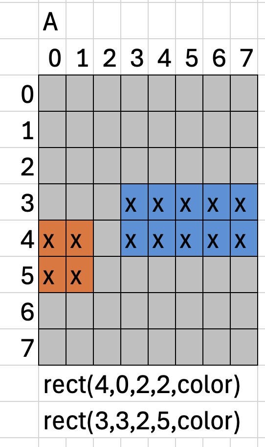
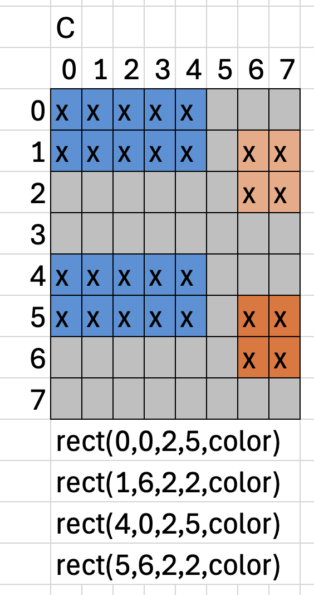

# Clase solo para vincent del 28 de octubre

## Código de wokwi que trabajamos hasta el final

aprendimos a incluir un potenciómetro para controlar el brillo usando map


```arduino
#include <Adafruit_NeoPixel.h>

#define PIN        6
#define NUMPIXELS  64
#define SERPENTINA false   // true si tu matriz zigzaguea por filas

int potpin = A5;
int valorpot = 0;
int intensidadLuz = 0;

Adafruit_NeoPixel strip(NUMPIXELS, PIN, NEO_GRB + NEO_KHZ800);

int indice(int fila, int col) {
  if (SERPENTINA && (fila % 2 == 1)) col = 7 - col;
  return fila * 8 + col;
}

void rect(int f0, int c0, int alto, int ancho, uint32_t color) {
  for (int f = f0; f < f0 + alto; f++)
    for (int c = c0; c < c0 + ancho; c++)
      strip.setPixelColor(indice(f, c), color);
}

void setup() {

  strip.begin();
  strip.setBrightness(127);   // IMPORTANTE, ver nota
  strip.clear();


}

void loop() {
    valorpot = analogRead(potpin);
  // map reconvierte rango
  // map (valor a convertir, inicial bajo, inicial alto, final bajo, final alto)
  // vamos a convertir de 0-1023 a 1-127 porque no queremos que se apague la pantalla
  // ni quedar ciegos
  intensidadLuz = map(valorpot, 0, 1023, 1, 127);
  strip.setBrightness(intensidadLuz);   // IMPORTANTE, ver nota

 // VACÍO
  strip.clear();
  rect(0, 0, 8, 8, strip.Color(0, 0, 0));   // punto (ámbar)
  strip.show();
  delay(100);


  //fila, columna, medida en y, medida en x
  //esto es una A
  strip.clear();
  rect(4, 0, 2, 2, strip.Color(255, 160, 0));   // punto (ámbar)
  rect(3, 3, 2, 5, strip.Color(0, 160, 255));   // raya (azul)
  strip.show();
  delay(1000);

  // VACÍO
  strip.clear();
  rect(0, 0, 8, 8, strip.Color(0, 0, 0));   // punto (ámbar)
  strip.show();
  delay(100);

  //esto es una E
  strip.clear();
  rect(4, 0, 2, 2, strip.Color(255, 160, 0));   // punto (ámbar)
  strip.show();
  delay(1000);


}
```

## Versión de lectura inmediata de pot

para esto usamos una función de arduino llamada millis(); que me ayuda a calcular tiempos sin usar delay (es decir, sin paralizar el código)

```arduino
#include <Adafruit_NeoPixel.h>

#define PIN        6
#define NUMPIXELS  64
#define SERPENTINA false   // true si tu matriz zigzaguea por filas

int potpin = A5;
int valorpot = 0;
int intensidadLuz = 0;

Adafruit_NeoPixel strip(NUMPIXELS, PIN, NEO_GRB + NEO_KHZ800);

int indice(int fila, int col) {
  if (SERPENTINA && (fila % 2 == 1)) col = 7 - col;
  return fila * 8 + col;
}

void rect(int f0, int c0, int alto, int ancho, uint32_t color) {
  for (int f = f0; f < f0 + alto; f++)
    for (int c = c0; c < c0 + ancho; c++)
      strip.setPixelColor(indice(f, c), color);
}

// reemplazo de delay(): mientras espera, sigue leyendo el potenciómetro
void esperar(unsigned long ms) {
  unsigned long inicio = millis();
  while (millis() - inicio < ms) {
    valorpot = analogRead(potpin);
    // map (valor a convertir, inicial bajo, inicial alto, final bajo, final alto)
    // de 0-1023 a 1-127 para que no se apague ni nos deje ciegos
    intensidadLuz = map(valorpot, 0, 1023, 1, 127);
    strip.setBrightness(intensidadLuz);
    strip.show();
    delay(10);
  }
}

void setup() {
  strip.begin();
  strip.setBrightness(127);
  strip.clear();
}

void loop() {
  // VACÍO
  strip.clear();
  strip.show();
  esperar(100);

  //fila, columna, medida en y, medida en x
  //esto es una A
  strip.clear();
  rect(4, 0, 2, 2, strip.Color(255, 160, 0));   // punto (ámbar)
  rect(3, 3, 2, 5, strip.Color(0, 160, 255));   // raya (azul)
  strip.show();
  esperar(1000);

  // VACÍO
  strip.clear();
  strip.show();
  esperar(100);

  //esto es una E
  strip.clear();
  rect(4, 0, 2, 2, strip.Color(255, 160, 0));   // punto (ámbar)
  strip.show();
  esperar(1000);
}
```

## guía para dibujar letras en morse



