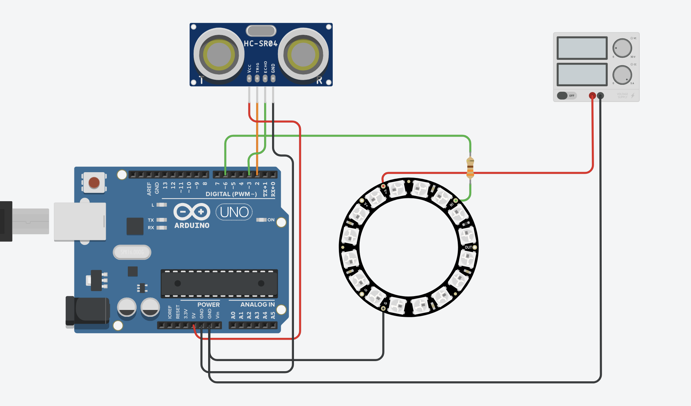

# Clase vincent 21 de octubre

- <https://github.com/matbutom/cheap-diy-camera>
- conversamos sobre distintas pantallas y sus protocolos (i2c, spi)
- trabajamos con las pantallas de leds de neopixel, creados por AdaFruit

## Código para anillo de leds neopixel de 16 con sensor de proximidad

- Sensor disponible en <https://afel.cl/products/sensor-de-ultrasonico-hc-sr04>
- Pantalla disponible en <https://afel.cl/products/anillo-led-rgb-ws2812-de-16-leds>



```arduino
#include <Adafruit_NeoPixel.h>

#define PIN_LED   6
#define NUM_LEDS  16
#define PIN_TRIG  2
#define PIN_ECHO  3

#define DIST_ROJO 30.0     // cm: rojo puro (gradiente)
#define DIST_AZUL 200.0    // cm: azul puro (gradiente)

#define COLAPSO_ENTRA 50.0 // cm: por debajo de esto, modo colapso
#define COLAPSO_SALE  60.0 // cm: hay que superar esto para salir (histéresis)

#define INTERVALO_MS 60
#define SUAVIZADO    0.3

Adafruit_NeoPixel anillo(NUM_LEDS, PIN_LED, NEO_GRB + NEO_KHZ800);

float distanciaSuave = DIST_AZUL;
bool primeraLectura = true;
unsigned long ultimaMedicion = 0;
bool modoColapso = false;

// Estado individual de cada LED en modo colapso
unsigned long proximoCambio[NUM_LEDS];
bool encendido[NUM_LEDS];
float ritmo[NUM_LEDS];   // factor personal de velocidad de cada LED

void setup() {
  pinMode(PIN_TRIG, OUTPUT);
  pinMode(PIN_ECHO, INPUT);
  randomSeed(analogRead(A0));   // A0 sin conectar = semilla aleatoria
  anillo.begin();
  anillo.setBrightness(40);
  anillo.show();
}

void loop() {
  // 1) Medición periódica (decide el modo)
  if (millis() - ultimaMedicion >= INTERVALO_MS) {
    ultimaMedicion = millis();

    float d = medirDistancia();
    if (d < 0) d = DIST_AZUL;

    if (primeraLectura) {
      distanciaSuave = d;
      primeraLectura = false;
    } else {
      distanciaSuave = SUAVIZADO * d + (1.0 - SUAVIZADO) * distanciaSuave;
    }

    // Histéresis: entra a 50 cm, sale a 60 cm
    if (!modoColapso && distanciaSuave < COLAPSO_ENTRA) {
      modoColapso = true;
      iniciarColapso();
    } else if (modoColapso && distanciaSuave > COLAPSO_SALE) {
      modoColapso = false;
    }

    if (!modoColapso) mostrarGradiente(distanciaSuave);
  }

  // 2) Animación: corre en cada vuelta del loop, sin depender de la medición
  if (modoColapso) animarColapso();
}

float medirDistancia() {
  digitalWrite(PIN_TRIG, LOW);
  delayMicroseconds(2);
  digitalWrite(PIN_TRIG, HIGH);
  delayMicroseconds(10);
  digitalWrite(PIN_TRIG, LOW);

  long duracion = pulseIn(PIN_ECHO, HIGH, 25000);
  if (duracion == 0) return -1;
  return duracion * 0.0343 / 2.0;
}

void mostrarGradiente(float distancia) {
  float t = (distancia - DIST_ROJO) / (DIST_AZUL - DIST_ROJO);
  t = constrain(t, 0.0, 1.0);
  uint8_t r = 255 * (1.0 - t);
  uint8_t b = 255 * t;
  anillo.fill(anillo.gamma32(anillo.Color(r, 0, b)));
  anillo.show();
}

// Reparte ritmos y tiempos distintos a cada LED al entrar en colapso
void iniciarColapso() {
  unsigned long ahora = millis();
  anillo.clear();
  for (int i = 0; i < NUM_LEDS; i++) {
    encendido[i] = false;
    ritmo[i] = random(40, 200) / 100.0;       // 0.4x a 2x
    proximoCambio[i] = ahora + random(0, 300); // arranque escalonado
  }
  anillo.show();
}

void animarColapso() {
  unsigned long ahora = millis();
  bool huboCambio = false;

  for (int i = 0; i < NUM_LEDS; i++) {
    if (ahora < proximoCambio[i]) continue;

    encendido[i] = !encendido[i];

    if (encendido[i]) {
      // Rojo o naranja al azar
      uint32_t c = (random(2) == 0) ? anillo.Color(255, 0, 0)
                                    : anillo.Color(255, 70, 0);
      anillo.setPixelColor(i, anillo.gamma32(c));
      proximoCambio[i] = ahora + (unsigned long)(random(40, 220) * ritmo[i]);
    } else {
      anillo.setPixelColor(i, 0);
      proximoCambio[i] = ahora + (unsigned long)(random(30, 350) * ritmo[i]);
    }
    huboCambio = true;
  }

  if (huboCambio) anillo.show();   // solo transmite si algo cambió
}
```

## Proyecto de morse en neopixel

<https://wokwi.com/projects/478525152856219649>

## Grabación clase

<https://youtu.be/uFYCEsVGEbg>
